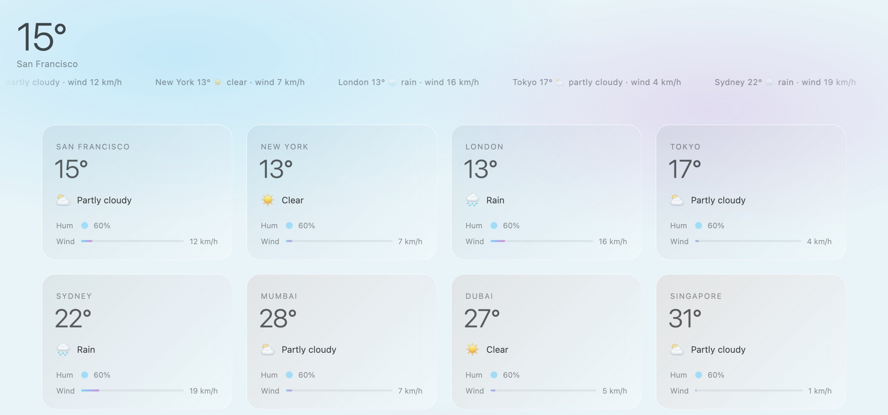

<div align="center">

<h1>aeris</h1>

<p><b>Twelve cities' weather on frosted-glass cards.</b></p>

<p><i>One scroll from San Francisco to São Paulo, with each card tinted by how warm it is there right now.</i></p>

<h6>


</h6>

<a href="https://aeris.parthchandak.info"><b>Live demo</b></a> ·
<a href="#how-it-works"><b>How it works</b></a> ·
<a href="#run-it"><b>Run it</b></a>

<br><br>

<a href="https://aeris.parthchandak.info"></a>

<sub>Live capture, 22 October 2026. Real Open-Meteo data, top of the page.</sub>

</div>

<br>

A small world-weather board in one HTML file. On load it asks
[Open-Meteo](https://open-meteo.com) for current conditions in San Francisco, New York,
London, Tokyo, Sydney, Mumbai, Dubai, Singapore, Paris, Berlin, Toronto and São Paulo, then
lays them out as glass cards that rise into place as you scroll. No API key, no build step.

## How it works

| Data (per city) | Drives |
|---|---|
| Temperature | The card's gradient, from cool blue at -5 °C to warm coral at 45 °C, and the big number |
| Weather code | Icon and label: clear, partly cloudy, foggy, rain, snow, showers, snow showers, storm |
| Wind speed | Width of the wind bar, 0 to 60 km/h |
| Relative humidity | Opacity of the humidity dot |

San Francisco is the headline number top-left; a ticker across the top cycles every city's
temperature, conditions and wind. Click or tap a card and a panel opens with its temperature,
feels-like, humidity, wind, pressure and precipitation, then fades after four seconds idle.
The stamp in the bottom-left reads `live` or `fallback`, so the page never passes canned
numbers off as real.

Every value comes from one Open-Meteo `current=` request per city, refreshed every ten
minutes. If a refresh fails the last live numbers stay up and the stamp's age keeps counting.

## Run it

```bash
git clone https://github.com/parthchandak02/aeris.git
cd aeris
python3 -m http.server 8000   # then open http://localhost:8000
```

Everything lives in `index.html`: the `C` object at the top of the script holds the city list,
palette, motion timings and value ranges. `brief.md` is the original creative brief. The live
version is hosted on Cloudflare Pages.

<br>

<div align="center">
<sub>Built with HTML, CSS and Anime.js. Data from Open-Meteo.</sub>
</div>
